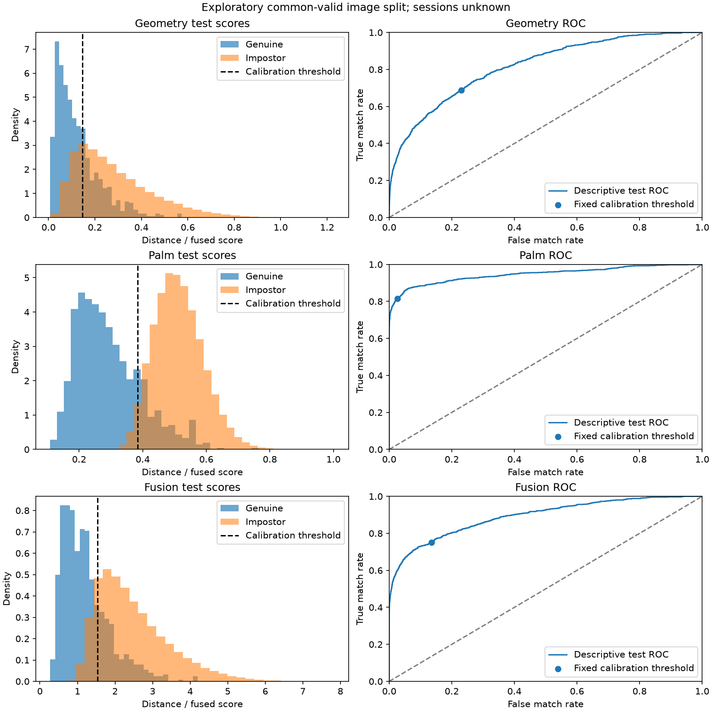
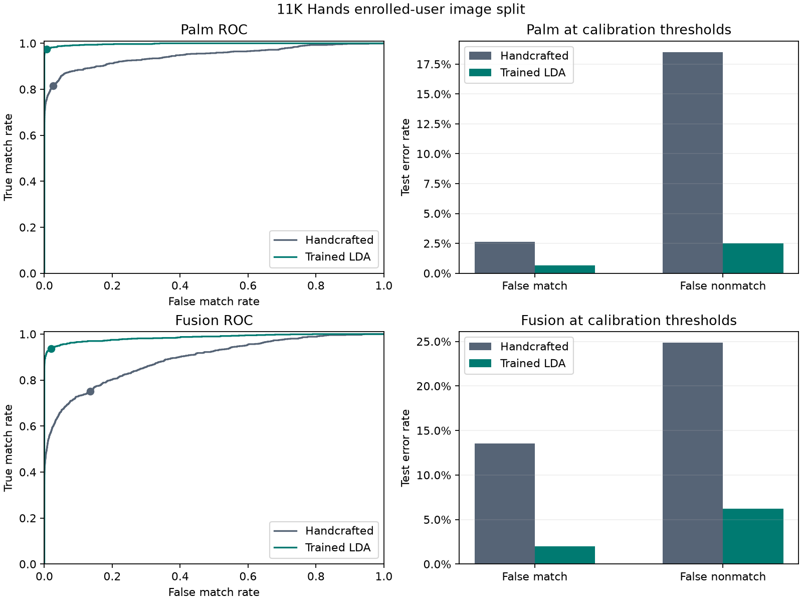
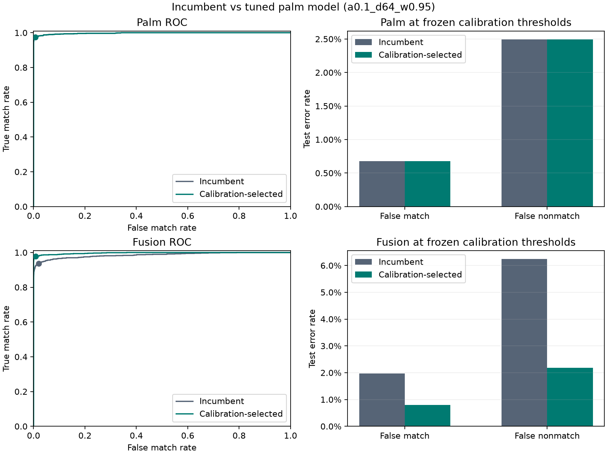
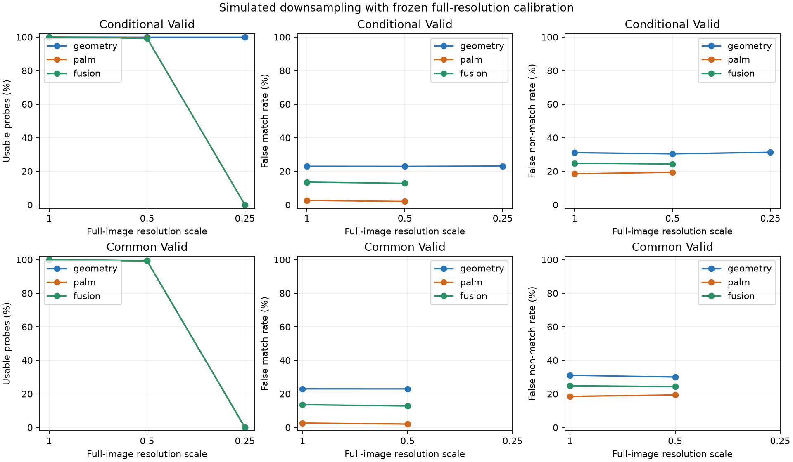
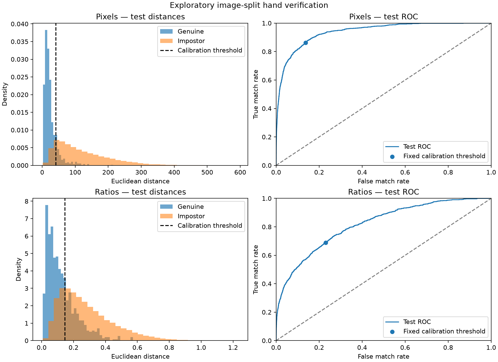

# Hand Geometry and Palmprint Verification

A Biometrics course project at Sapienza University of Rome. The application verifies a claimed identity using the geometry and central-palm texture of an open right hand in one combined comparison.

## Combined hand enrollment and verification

The desktop application uses one enrollment and one verification workflow. Each of 10 manually captured images supplies both finger-to-palm ratios and an aligned palmprint descriptor. The verification screen displays a single combined ACCEPT / REJECT result.

The repository includes `configs/palm_reference.json`, containing the current trained palm projection, operating thresholds, normalization scales, descriptor settings, and experiment provenance. It uses a 64-dimensional LDA projection with shrinkage 0.1 and a 95% palm / 5% geometry weighted average of the normalized component distances. Personal templates are created locally during enrollment. Existing personal profiles keep the reference and thresholds they were created with; use `--reenroll` to create a fresh 10-image session against the current reference. After installing the Python packages and downloading `hand_landmarker.task`, the interactive combined workflow can start directly from the code checkout.

Use `start.cmd` for the desktop menu, or use CMD:

```cmd
.venv\Scripts\python.exe palm_demo.py --user musa
```

The first run collects the user's hand samples. Press **Space** or click **Save sample** to save each usable image, remove the hand, and show it again. The progress bar counts saved samples. Later runs use the latest completed `captures/USER/SESSION/palm_model.json`. `--reenroll` creates a fresh session. **S** saves the displayed comparison and its results. **Q / Esc** closes the window.

Four subtle corner guides show the exact source region used for palm analysis. The main view displays a contrast-enhanced palm detail image and a current readiness message. Press **D** to show the raw crop, Gabor responses, and acquisition measurements. Contrast enhancement in this preview is a display operation. The recognizer uses its calibrated feature pipeline.

Palm samples are stored as lossless PNG images with their measurements. The palm crop is normalized to 128 × 128 pixels and described using six Gabor orientations over an 8 × 8 grid, producing 384 normalized texture features. The source crop must span at least 64 pixels and have grayscale standard deviation at least 3. Sharpness is recorded for analysis. This descriptor measures local line and texture responses.

The initial handcrafted baseline uses an equal-weight average of geometry and palm distances, each divided by its calibration genuine-distance median. Each operating threshold minimizes calibration balanced error. The table below records this initial baseline on the same enrolled users and held-out photographs.

| Method | Test FMR | Test FNMR |
| --- | --- | --- |
| Hand geometry ratios | 22.99% | 31.08% |
| Palm texture | 2.61% | 18.50% |
| Combined score | 13.54% | 24.84% |



This run processed 2,813 right-palmar photographs, with 2,778 usable paired measurements. The common cohort contains 174 users, 1,015 enrollment images, 739 calibration images, and 962 test images. Each method has 962 genuine and 166,426 impostor test comparisons. Palm texture performs best in this initial image-split experiment. Equal-weight fusion improves on geometry alone. Future capture sessions and volunteers are required to measure webcam operating performance.

Full results are generated under `outputs/palm_evaluation/`. To reproduce the calibration and comparison:

```cmd
.venv\Scripts\python.exe prepare_palm.py --archive "C:\path\to\Hands.zip" --metadata "C:\path\to\HandInfo.csv" --output outputs\palm_evaluation
```

## Trained palm recognition: historical incumbent

The first trained reference included a supervised regularized Linear Discriminant Analysis projection. It learned 64 dimensions from the 384 raw palm features, using only the 1,015 enrollment images from 174 identities. The within-class covariance used fixed shrinkage 0.1. Projection fitting used the enrollment partition, while threshold selection and normalization used the separate 739-image calibration partition.

The historical fusion experiment tested palm weights 0.25, 0.5, and 0.75 on calibration images. It selected a 75% palm and 25% geometry weighted average of normalized component distances. Both components contribute to the single application verdict. This frozen incumbent was evaluated on the 962 held-out images.

| Method | Test FMR | Test FNMR |
| --- | --- | --- |
| Initial palm texture | 2.61% | 18.50% |
| Trained palm metric | 0.68% | 2.49% |
| Initial combined score | 13.54% | 24.84% |
| Trained combined score | 1.97% | 6.24% |



Training and inference use the same raw descriptor and projected-distance calculation. Cached raw personal descriptors remain compatible. The reference used when creating a profile freezes that profile's metric and thresholds. The evaluated identities also appear in enrollment, so these image-split measurements do not establish independent identity or webcam generalization.

After preparing the dataset features, reproduce training with:

```cmd
.venv\Scripts\python.exe train_palm.py
```

The output directory `outputs/palm_trained/` contains the full incumbent model, aggregate reference, comparison plot, and summary. The public aggregate reference contains learned weights and calibration information. Personal templates remain in local capture sessions.

## Bounded palm fusion optimization

A bounded calibration-only sweep compared 60 configurations with the fixed incumbent: shrinkage values 0.01, 0.1, and 0.5; dimensions 16, 32, 64, 96, and 128; and palm weights 0.5, 0.75, 0.9, and 0.95. It selected `a0.1_d64_w0.95`: the projection stayed at 64 dimensions and shrinkage 0.1, while the palm weight changed to 95% (geometry 5%) in the average of normalized distances. Thus, the measured change is in calibration-selected fusion, not evidence of a better LDA embedding. The incumbent wins when rounded calibration fusion balanced error and then false-match rate do not strictly improve.

Calibration fusion balanced error decreased from 3.92% to 1.36%. The model's parameters, normalization, and thresholds were frozen before evaluation on the historical test split. That split contains enrolled identities and 962 probes; it is exploratory and not a fresh untouched holdout.

| Evaluation | Method | False accepts / impostor comparisons (FMR) | False rejects / genuine probes (FNMR) |
| --- | --- | ---: | ---: |
| Historical 962-probe split | Incumbent fusion | 3,273 / 166,426 (1.97%) | 60 / 962 (6.24%) |
| Historical 962-probe split | Tuned fusion | 1,320 / 166,426 (0.79%) | 21 / 962 (2.18%) |
| Historical 962-probe split | Palm only, unchanged | 1,129 / 166,426 (0.68%) | 24 / 962 (2.49%) |
| 13 identities outside training | Incumbent fusion | 18 / 408 (4.41%) | 6 / 34 (17.65%) |
| 13 identities outside training | Tuned fusion | 9 / 408 (2.21%) | 7 / 34 (20.59%) |
| 13 identities outside training | Palm only, unchanged | 7 / 408 (1.72%) | 6 / 34 (17.65%) |

On the historical split, tuned fusion reduced both reported error counts. The separate diagnostic's 13 eligible identities came from `insufficient_samples` manifest rows and are absent from the training cohort. Each identity has two common-valid enrollment photographs; the remaining common-valid images form 34 probes. Its error rates are conditional on both geometry and palm acquisition succeeding. Tuned fusion reduced false accepts but had one more false reject than the incumbent. Capture sessions are unknown, and the small probe count makes these estimates uncertain. Neither evaluation establishes webcam or cross-session performance, and the change is not a claim of generally better biometric accuracy.



Reproduce the sweep and the identity-disjoint diagnostic with the saved hash-bound features and splits:

```cmd
.venv\Scripts\python.exe optimize_palm.py
.venv\Scripts\python.exe evaluate_palm_transfer.py
```

The optimizer writes the selected model, sanitized public reference, search table, summary, and comparison chart under `outputs/palm_tuned/`. The transfer evaluator uses a separate identity-disjoint split for a frozen diagnostic; it does not select or activate a model.

Live capture requests 1280 × 720 pixels by default, and the preview shows the actual input dimensions returned by the camera. `--camera-width` and `--camera-height` can request another supported mode. If the palm crop is too small, the preview guides the user to move closer while keeping the full hand visible. Personal registration stores reference samples for a user of the trained recognizer.

## Distance and resolution study

For a live experiment, declare the person presenting the hand and measure camera distance with a ruler or tape measure. Press **T** to record each attempt. The three component comparisons, image-quality measurements, distance, and digital scale are saved under `outputs/palm_trials/` as JSON and CSV. A failed palm or geometry measurement produces an unavailable combined decision and is counted as a feature-extraction failure.

```cmd
.venv\Scripts\python.exe palm_demo.py --user musa --actual musa --distance-cm 40 --condition day1 --scale 1
```

Change `--actual` for an impostor volunteer. Change the measured distance across runs while retaining the same saved enrollment. `--scale 0.5` digitally resizes the entire camera input before detection, allowing a controlled resolution experiment. The stored `distance_cm` is the operator's physical measurement, and `input_scale` is the digital downsampling factor.

To repeat the resolution experiment on held-out dataset images with frozen thresholds:

```cmd
.venv\Scripts\python.exe palm_robustness.py --archive "C:\path\to\Hands.zip" --model outputs\palm_evaluation\model.json --splits outputs\palm_evaluation\splits.csv --scales 1 0.5 0.25 --output outputs\palm_robustness
```

This experiment verifies the original split manifest and image hashes, resizes whole photographs, redetects landmarks, and reports coverage plus error rates for each method's valid probes and the common-valid subset. Image downsampling provides controlled resolution measurements. Physical distance results come from the separately measured webcam sessions.

The full resolution study used all 962 held-out images with fixed original calibration. At scale 0.5, 955 probes had both usable components. Conditional palm FMR/FNMR were 2.00%/19.35%, and combined FMR/FNMR were 12.80%/24.29%. At scale 0.25, every palm crop fell below the frozen 64-pixel source-size requirement, so palm and combined comparison rates are unavailable. Acquisition coverage is reported alongside the conditional error rates.



## What changed in this version

The previous version displayed hand landmarks and measurements. This version adds a complete experimental verification workflow:

- **Dataset processing:** extract right-palmar measurements directly from the 11K Hands ZIP, retaining acquisition failures for reporting.
- **Identity comparison:** build a median reference for each enrolled person, calibrate acceptance thresholds, and evaluate on separate test images.
- **Visible verification results:** show the claimed identity, comparison distance, threshold, and ACCEPT / REJECT decision for photographs or live camera frames.
- **Personal enrollment:** save 10 manually captured webcam samples, create a local profile, then remove and show the hand again for live comparison.
- **Experiment reports:** export split manifests, comparison scores, models, FMR/FNMR statistics, and result plots.
- **Validation:** automated tests cover measurements, extraction, matching, enrollment, file-write failures, and camera cleanup. Personal photographs and templates remain in Git-ignored local directories.

This is a working research prototype. The dataset results below show substantial errors, and personal webcam verification currently uses a transferred dataset threshold. Webcam-specific calibration and independent accuracy testing remain future work.

## Reliability improvements

- Enrollment waits for the hand to leave the frame between successful captures, so holding Space cannot fill the profile with repeated samples. Exact duplicate JPEG captures are also rejected.
- Interrupted model writes are cleaned up, and publishing a profile preserves an existing model file.
- Model loading rejects malformed values and non-finite numbers. Distance calculations handle extreme finite values without silently converting a nonzero distance to zero.
- Invalid dataset headers, rows, and score labels fail clearly. Extraction stages its feature CSV and provenance metadata before publication.
- `verify.py --user musa --camera 0` opens the latest completed personal session without copying a model path. Incomplete sessions are skipped; a corrupt selected profile reports an error.
- Empty photographs report a clear decoding error. Both uppercase and lowercase Q close the application.

These changes address correctness and usability. Dataset scores are exploratory enrolled-user image-split measurements; they do not establish webcam or cross-session performance.

## Current implementation

- `app.py` provides a desktop menu for profile selection, enrollment, verification, and manual experiments.
- `palm_demo.py` and `palm_enrollment.py` implement the combined camera/photo workflow and paired personal capture sessions.
- `palmprint.py` extracts aligned palm texture, and `multimodal.py` scores the combined model.
- `prepare_palm.py` calibrates and evaluates the three research baselines on matched data splits.
- `palm_trials.py` records measured-distance trials, and `palm_robustness.py` evaluates resolution changes at frozen thresholds.
- `optimize_palm.py` searches bounded LDA and palm-fusion settings using calibration-only model selection.
- `evaluate_palm_transfer.py` evaluates frozen models on an identity-disjoint diagnostic split.
- `palm_learning.py` fits and applies the regularized LDA palm projection.
- `train_palm.py` produces the fixed incumbent model and calibration report used by the bounded sweep.
- `pilot.py` displays live landmarks, five finger lengths in pixels, and ratios to a palm-width proxy.
- `geometry.py` defines the shared measurements and acquisition-quality checks.
- `extract_features.py` reads the 11K Hands ZIP and metadata and writes right-palmar measurements and failure statuses to CSV.
- `matching.py` builds median enrollment templates and compares a probe with one claimed user's template using Euclidean distance.
- `evaluate.py` exports calibrated models, image split manifests, comparison scores, metrics, and plots.
- `verify.py` applies an exported model to a photograph or a live camera stream.
- `enroll.py` collects personal webcam samples and switches to live comparison with the new profile.
- `enrollment.py` stores local capture sessions and builds personal median templates.
- `experiment.py` collects manually triggered webcam comparison attempts with a declared actual subject.
- `trial_log.py` stores those attempts and exports CSV records and summary metrics.
- `snapshots.py` saves a verification screenshot with the decision and model fingerprint.

OpenCV handles capture and drawing. The pretrained MediaPipe Hand Landmarker supplies 21 points. Feature calculations, quality rules, enrollment, comparison, calibration, and evaluation are implemented in this repository.

## Windows setup

Use Python 3.12 and select **Command Prompt** as the VS Code terminal profile. Run these commands from the repository folder for a fresh checkout.

```cmd
python -m venv .venv
.venv\Scripts\python.exe -m pip install -r requirements.txt
curl.exe --fail --location --output hand_landmarker.task https://storage.googleapis.com/mediapipe-models/hand_landmarker/hand_landmarker/float16/latest/hand_landmarker.task
```

## Desktop menu

Double-click **start.cmd**, or run it from the repository folder:

```cmd
start.cmd
```

The menu has three compact tabs. Under **Enroll**, enter a user ID and choose **Enroll hand** to capture the paired geometry and palm samples. Under **Verify**, select a profile and use **Start camera** or **Choose photo**. Its summary shows the saved palm/geometry fusion weights and whether its matcher calibration matches the bundled default; incomplete metadata is shown as unknown. Profiles retain the calibration saved at enrollment, so use **Update selected profile**, then choose **Enroll hand**, to create a new session for that same ID using current defaults. Enrollment starts only when you choose **Enroll hand**. The camera shows a live combined result. Close the active window with **Q** or **Esc** to return. Profiles refresh automatically when an action finishes.

Under **Experiments**, select a profile, enter the **Actual person ID**, and choose **Run experiment**. Use the selected profile's ID for genuine attempts or a volunteer's ID for impostor attempts. The tab also holds the condition, measured distance, digital input scale, and camera index. Press **T** in the camera window to record each attempt. The panel identifies which field needs attention if a required value is missing or invalid. Choose **View results** to review saved attempts without selecting a profile; **Refresh** reads the metadata again and works while a capture session is open. The compact table groups each model, condition, distance, and input scale separately. FMR is false accepts divided by valid impostor comparisons; FNMR is false rejects divided by valid genuine comparisons. Acquisition failures are excluded from both rates, shown separately, and remain in attempt totals. The selected-group details include run and profile IDs, the full model hash, genuine/impostor totals, comparisons, coverage, and thresholds. **Save HTML…** writes the displayed report to a chosen path, initially `outputs/reports/`, without opening a browser.

To compile and save an HTML report from CMD:

```cmd
.venv\Scripts\python.exe palm_reports.py --root outputs\palm_trials
```

Without another option, the CLI chooses a unique HTML filename in `outputs/reports/`. To use a fixed path, run `.venv\Scripts\python.exe palm_reports.py --root outputs\palm_trials --output outputs\reports\summary.html`.

The combined workflow uses the included aggregate reference `configs/palm_reference.json`. The Python environment and Hand Landmarker setup above are required. Profiles created with the original geometry workflow collect a fresh paired enrollment when upgraded through the camera. Live verification prepares the saved model and palm projection once per camera session, rebuilding them after a new enrollment completes; frames reuse those settings without changing saved thresholds or scores. Live camera display starts mirrored; press **M** to toggle it. **F** toggles the display-only hand-focused viewport, which starts on and falls back to full view unless the current frame has one complete in-frame hand; any available palm guides must also fit safely. Zooming the display does not increase the palm crop's native pixels or relax its configured 64-pixel quality gate. Analysis, scoring, and enrollment continue to use the full original camera frame; photo verification is always full-view and unmirrored. The camera overlay reports current hand presence, with distinct live prompts for no hand and tracked but unusable frames. Prompts guide whole-hand framing, the configured minimum palm crop, and even lighting.

## Save a screenshot and decision

In photograph or live verification, press **S** to save the displayed result. Each request creates a new directory under `outputs/snapshots/` containing `preview.png` and `decision.json`. The JSON records the matching decision, method, timestamp, image hash, and model fingerprint. Enrollment templates are not included. The same shortcut is available after enrollment switches to verification.

Screenshots are local biometric records and remain Git-ignored. One saved result illustrates a comparison; it is not an accuracy estimate.

## Collect webcam test attempts

The commands in this section reproduce the earlier geometry-only experiments. The menu's Experiments tab uses the combined workflow described above. For the earlier pipeline, run:

```cmd
.venv\Scripts\python.exe experiment.py --user musa --actual musa --condition day1-normal --camera 0
```

`--user` selects the claimed identity's latest completed profile. `--actual` declares who is presenting the hand: use the same ID for a genuine attempt, or a different volunteer's ID for an impostor attempt. For example:

```cmd
.venv\Scripts\python.exe experiment.py --user musa --actual volunteer1 --condition day1-normal --camera 0
```

Press **Space** once per attempt. Camera frames are not automatically counted. After a valid acquisition, remove the hand before making another attempt. Attempts are separated by at least one second. An unsuccessful acquisition is recorded separately with no acceptance decision. **Q / Esc** closes the window and exports the results.

Each run is stored under `outputs/experiments/` with per-attempt records, `trials.csv`, and `summary.json`. Reports identify the frozen model and threshold, declared subjects, capture condition, valid genuine/impostor counts, acquisition failures, FMR, and FNMR. A rate without any eligible comparisons is `null`, shown as n/a. These logs store decisions rather than photographs. A local `model.json` snapshot preserves the model fingerprint; it contains enrollment templates and stays Git-ignored with the rest of the run.

The actual subject is declared by the operator; it is not inferred by the system. Manually separated attempts can still be correlated. Collect multiple volunteers and different days or capture conditions, and keep calibration captures separate from the final test. This mode measures the fixed model and does not tune its threshold.

## Webcam measurement pilot

```cmd
.venv\Scripts\python.exe pilot.py
```

Show one open right palm facing the camera, with all fingertips visible. Move closer and farther away while keeping the pose steady, then compare pixels and ratios. Press **Q** or **Esc** to close the window. Use `--camera 1` to select a second camera.

Finger lengths follow the visible finger joints. Palm width is represented by the distance between the index and little finger base joints, landmarks 5 and 17. Normalized points are converted using image width for x and image height for y before measuring distances. The wrist and thumb CMC are unused, so a cropped wrist does not invalidate otherwise usable fingers.

Quality statuses distinguish no hand, multiple hands, invalid points, out-of-frame finger points, and degenerate geometry. These checks assess measurement availability. Hand pose and palm-facing orientation still require care during capture.

## Enroll your own hand

After generating `outputs/evaluation/model_ratios.json` with the dataset workflow below, run:

```cmd
.venv\Scripts\python.exe enroll.py --user musa
```

Use a short user ID containing letters, numbers, underscores, or hyphens. The enrollment window opens the camera. Show one open right palm with all fingertips in the frame, then press **Space** to save a sample. Collect **10** usable samples. After each successful capture, remove the hand from the frame, then show the palm again before pressing Space. The counter increases only when a sample is saved, with at least 0.8 seconds between captures. Repeated identical JPEG captures do not increase the count.

After the final sample, the application saves the profile and switches to live verification with that same user ID. Remove your hand and show it again to try the comparison. **Q** or **Esc** closes the window. `--camera 1` selects another camera. Images are saved only when you press Space during enrollment.

Each run creates a separate directory under `captures/USER_ID/`, containing the captured photographs, measurements, and `model.json`. The terminal prints the model path. To reuse the latest completed profile later:

```cmd
.venv\Scripts\python.exe verify.py --user musa --camera 0
```

The default capture root is next to the script. Use `--captures "C:\path\to\captures"` with `--user` for another root. To choose a specific session:

```cmd
.venv\Scripts\python.exe verify.py --model "captures\musa\SESSION\model.json" --claim musa --camera 0
```

Replace `SESSION` with the session directory printed after enrollment. The `captures/` directory is ignored by Git. Cancelling an incomplete session leaves its partial captures on disk without producing a completed profile; previous sessions are preserved.

The personal template is the median of the five finger-to-palm-width ratios from the enrollment samples. Its acceptance threshold is transferred unchanged from the dataset ratio model. This is a **personal webcam demo**, with no webcam-specific calibration yet. Same-session captures and live frames demonstrate the workflow; they do not establish cross-session accuracy or rejection of other people. Separate volunteers and later sessions are needed to calibrate and test those properties.

## Extract dataset measurements

Download `Hands.zip` and `HandInfo.csv` from the [11K Hands project page](https://sites.google.com/view/11khands/home). The ZIP can be read directly. Substitute the directory containing your downloads below.

```cmd
set "DATA_DIR=C:\path\to\11k-hands"
.venv\Scripts\python.exe extract_features.py --archive "%DATA_DIR%\Hands.zip" --metadata "%DATA_DIR%\HandInfo.csv" --output outputs\features.csv
```

The CSV records image name, subject ID, image SHA-256, quality status, palm-width proxy, five pixel lengths, and five ratios. Failed captures retain their identifiers and status with blank measurements. A companion `features.meta.json` records input/model hashes, versions, and counts. Use `--limit 20` for a small smoke check.

## Evaluate verification

```cmd
.venv\Scripts\python.exe evaluate.py --features outputs\features.csv --output outputs\evaluation --seed 42
```

Each eligible user needs at least six valid captures. Approximately 40% of each user's images form the enrollment template, 30% calibrate the threshold, and the remainder are held out for testing. Duplicate image names and exact-content hashes are rejected before splitting. Both methods use the same splits and quality-approved captures.

Each reference is the component-wise median of enrollment measurements. A comparison accepts when its distance is at or below a global threshold. Each method minimizes calibration balanced error, the average of FMR and FNMR. Ties prefer fewer false matches and then a smaller threshold. Testing uses that frozen threshold.

This is an exploratory **enrolled-user image split**. The same enrolled identities appear in all three roles using different photographs. 11K Hands provides no capture-session or measured camera-distance labels. Near-duplicate frames may remain correlated even after exact-duplicate checks. Separate webcam and session data are needed to evaluate those conditions.

### Initial run, seed 42

The archive and metadata contain 11,076 images. The selected view has 2,813 images from 188 subjects. Extraction produced 2,778 valid measurements, 18 out-of-frame finger failures, and 17 no-hand failures. The acquisition failure fraction was 35/2,813, approximately 1.24%.

The experiment enrolled 174 eligible users. Its splits contain 1,015 enrollment, 739 calibration, and 962 test images. The remaining 62 valid images came from 14 users with fewer than six usable captures.

| Method | Test false matches | Test FMR | Test false non-matches | Test FNMR | Descriptive test EER |
| --- | --- | --- | --- | --- | --- |
| Five pixel lengths | 22,793 / 166,426 | 13.70% | 132 / 962 | 13.72% | 13.72% |
| Five palm-width ratios | 38,256 / 166,426 | 22.99% | 299 / 962 | 31.08% | 26.72% |



The normalized representation performed worse in this initial image-split experiment. These error rates remain substantial for identity verification. Scale normalization removes size information as well as projected scale, and its benefit under controlled camera-distance changes remains an experimental question.

FMR is the fraction of valid impostor comparisons accepted. FNMR is the fraction of valid genuine comparisons rejected. Acquisition failures are reported separately. Descriptive EER and ROC-AUC summarize the test-score curve, while operating thresholds are selected using calibration images. The impostor comparisons share probes, users, and templates and must not be treated as independent physical trials.

### Generated files

- `summary.json` contains counts, fixed-threshold metrics, exclusions, and protocol details.
- `splits.csv` assigns eligible images to enrollment, calibration, or test.
- `scores.csv` records every calibration and test comparison for both methods.
- `model_pixels.json` and `model_ratios.json` contain calibrated thresholds and enrollment templates.
- `verification_curves.png` shows test-distance distributions and ROC curves with fixed operating points.

Evaluation writes into an empty output directory to preserve existing runs. Choose another `--output` directory for a repeat experiment.

## Try an exported model

Select a subject ID from the exported model's `templates` object. Image mode prints capture status, distance, threshold, and decision as JSON.

```cmd
.venv\Scripts\python.exe verify.py --model outputs\evaluation\model_ratios.json --claim SUBJECT_ID --image "C:\path\to\hand.jpg"
```

Add `--show` to open a window with the photograph, measured landmarks, claimed identity, acceptance decision, distance, and calibrated threshold. The measurement pilot only displays geometry; use `verify.py` to see the new matching behavior.

Camera mode shows exploratory matching scores.

```cmd
.venv\Scripts\python.exe verify.py --model outputs\evaluation\model_ratios.json --claim SUBJECT_ID --camera 0
```

Models exported by `evaluate.py` contain dataset participants. Personal models created by `enroll.py` contain the chosen local user ID. Camera and dataset comparisons use the same five-finger features. Failed acquisition returns `accepted` and `distance` as null with a separate quality status. Personal webcam calibration with additional volunteers and sessions remains future work.

## Checks

```cmd
.venv\Scripts\python.exe -m unittest discover -s tests -v
```

The focused checks cover geometry scaling and image aspect ratio, cropped/invalid points, extraction failures, duplicate-input protection, disjoint splitting, median templates, threshold polarity, model validation, capture spacing, partial-write recovery, personal-model provenance, and verification cleanup. They also check that opening enrollment saves no photographs and that verification waits for hand removal and a fresh frame. Real-image extraction, image-mode inference, and an offline personal-profile round trip were checked. Personal webcam capture remains an interactive manual step.

## Local data

Store biometric captures, derived features, and exported templates under `data/`, `captures/`, or `outputs/`. Git ignores these directories, the Python environment, and downloaded models. The source dataset's academic-use terms and citation apply to its images.

## Roadmap

- **V1 — Desktop usability (implemented):** unified enrollment, verification, and experiments, with saved calibration awareness and explicit profile updates.
- **V2 — Local trial reporting (implemented):** fusion results grouped by model, condition, distance, and input scale, with conditional denominators, warnings, and HTML export.
- **V3 — Live camera guidance (implemented):** current tracking overlay, display-only **M** mirror and default-on **F** focus controls, with prompts for whole-hand framing, the minimum palm crop, and lighting. The viewport falls back to full view when the current hand or any available ROI cannot fit safely; display zoom does not change native crop quality. Analysis and capture use the original frame. Step-by-step coaching through the enrollment sample sequence remains future work.
- **V4 — Cross-session evaluation (planned):** collect later sessions and additional volunteers, then calibrate and evaluate on separate data before drawing webcam-performance conclusions.

## References

- Mahmoud Afifi, *11K Hands: Gender recognition and biometric identification using a large dataset of hand images*, Multimedia Tools and Applications, 2019. [Dataset and citation](https://sites.google.com/view/11khands/home).
- Google, [MediaPipe Hand Landmarker](https://developers.google.com/edge/mediapipe/solutions/vision/hand_landmarker/python).
- Adams Kong, David Zhang, Mohamed Kamel, *Palmprint identification using feature-level fusion*, Pattern Recognition, 2006. [Paper](https://doi.org/10.1016/j.patcog.2005.08.014).
- Loris Nanni, Alessandra Lumini, *Ensemble of multiple Palmprint representation*, Expert Systems with Applications, 2009. [Paper](https://doi.org/10.1016/j.eswa.2008.05.008).
