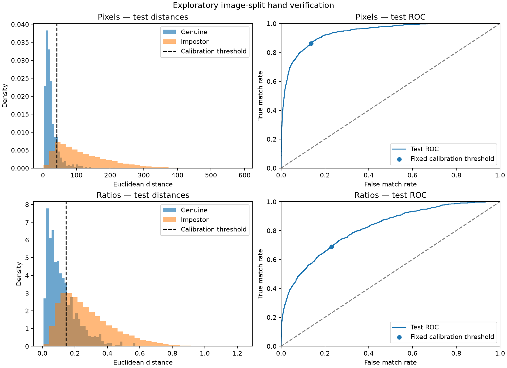

# Webcam Hand Geometry Verification

A Biometrics course project at Sapienza University of Rome. The project studies claimed-identity verification using the geometry of an open right hand.

## What changed in this version

The previous version displayed hand landmarks and measurements. This version adds a complete experimental verification workflow:

- **Dataset processing:** extract right-palmar measurements directly from the 11K Hands ZIP, retaining acquisition failures for reporting.
- **Identity comparison:** build a median reference for each enrolled person, calibrate acceptance thresholds, and evaluate on separate test images.
- **Visible verification results:** show the claimed identity, comparison distance, threshold, and ACCEPT / REJECT decision for photographs or live camera frames.
- **Personal enrollment:** save 10 manually captured webcam samples, create a local profile, then remove and show the hand again for live comparison.
- **Experiment reports:** export split manifests, comparison scores, models, FMR/FNMR statistics, and result plots.
- **Validation:** 30 automated tests cover measurements, extraction, matching, enrollment, file-write failures, and camera cleanup. Personal photographs and templates remain in Git-ignored local directories.

This is a working research prototype. The dataset results below show substantial errors, and personal webcam verification currently uses a transferred dataset threshold. Webcam-specific calibration and independent accuracy testing remain future work.

## Current implementation

- `pilot.py` displays live landmarks, five finger lengths in pixels, and ratios to a palm-width proxy.
- `geometry.py` defines the shared measurements and acquisition-quality checks.
- `extract_features.py` reads the 11K Hands ZIP and metadata and writes right-palmar measurements and failure statuses to CSV.
- `matching.py` builds median enrollment templates and compares a probe with one claimed user's template using Euclidean distance.
- `evaluate.py` exports calibrated models, image split manifests, comparison scores, metrics, and plots.
- `verify.py` applies an exported model to a photograph or a live camera stream.
- `enroll.py` collects personal webcam samples and switches to live comparison with the new profile.
- `enrollment.py` stores local capture sessions and builds personal median templates.

OpenCV handles capture and drawing. The pretrained MediaPipe Hand Landmarker supplies 21 points. Feature calculations, quality rules, enrollment, comparison, calibration, and evaluation are implemented in this repository.

## Windows setup

Use Python 3.12 and select **Command Prompt** as the VS Code terminal profile. Run these commands from the repository folder for a fresh checkout.

```cmd
python -m venv .venv
.venv\Scripts\python.exe -m pip install -r requirements.txt
curl.exe --fail --location --output hand_landmarker.task https://storage.googleapis.com/mediapipe-models/hand_landmarker/hand_landmarker/float16/latest/hand_landmarker.task
```

## Webcam measurement pilot

```cmd
.venv\Scripts\python.exe pilot.py
```

Show one open right palm facing the camera, with all fingertips visible. Move closer and farther away while keeping the pose steady, then compare pixels and ratios. Press **Q** or **Esc** to close the window. Use `--camera 1` to select a second camera.

Finger lengths follow the visible finger joints. Palm width is represented by the distance between the index and little finger base joints, landmarks 5 and 17. Normalized points are converted using image width for x and image height for y before measuring distances. The wrist and thumb CMC are unused, so a cropped wrist does not invalidate otherwise usable fingers.

Quality statuses distinguish no hand, multiple hands, invalid points, out-of-frame finger points, and degenerate geometry. These checks assess measurement availability. Hand pose and palm-facing orientation still require care during capture.

## Enroll your own hand

After generating `outputs/evaluation/model_ratios.json` with the dataset workflow below, run:

```cmd
.venv\Scripts\python.exe enroll.py --user musa
```

Use a short user ID containing letters, numbers, underscores, or hyphens. The enrollment window opens the camera. Show one open right palm with all fingertips in the frame, then press **Space** to save a sample. Collect **10** usable samples, slightly relaxing and repositioning the hand between captures while keeping the palm facing the camera. The counter increases only when a sample is saved, with at least 0.8 seconds between captures.

After the final sample, the application saves the profile and switches to live verification with that same user ID. Remove your hand and show it again to try the comparison. **Q** or **Esc** closes the window. `--camera 1` selects another camera. Images are saved only when you press Space during enrollment.

Each run creates a separate directory under `captures/USER_ID/`, containing the captured photographs, measurements, and `model.json`. The terminal prints the model path. To reuse a saved profile later:

```cmd
.venv\Scripts\python.exe verify.py --model "captures\musa\SESSION\model.json" --claim musa --camera 0
```

Replace `SESSION` with the session directory printed after enrollment. The `captures/` directory is ignored by Git. Cancelling an incomplete session leaves its partial captures on disk without producing a completed profile; previous sessions are preserved.

The personal template is the median of the five finger-to-palm-width ratios from the enrollment samples. Its acceptance threshold is transferred unchanged from the dataset ratio model. This is a **personal webcam demo**, with no webcam-specific calibration yet. Same-session captures and live frames demonstrate the workflow; they do not establish cross-session accuracy or rejection of other people. Separate volunteers and later sessions are needed to calibrate and test those properties.

## Extract dataset measurements

Download `Hands.zip` and `HandInfo.csv` from the [11K Hands project page](https://sites.google.com/view/11khands/home). The ZIP can be read directly. Substitute the directory containing your downloads below.

```cmd
set "DATA_DIR=C:\path\to\11k-hands"
.venv\Scripts\python.exe extract_features.py --archive "%DATA_DIR%\Hands.zip" --metadata "%DATA_DIR%\HandInfo.csv" --output outputs\features.csv
```

The CSV records image name, subject ID, image SHA-256, quality status, palm-width proxy, five pixel lengths, and five ratios. Failed captures retain their identifiers and status with blank measurements. A companion `features.meta.json` records input/model hashes, versions, and counts. Use `--limit 20` for a small smoke check.

## Evaluate verification

```cmd
.venv\Scripts\python.exe evaluate.py --features outputs\features.csv --output outputs\evaluation --seed 42
```

Each eligible user needs at least six valid captures. Approximately 40% of each user's images form the enrollment template, 30% calibrate the threshold, and the remainder are held out for testing. Duplicate image names and exact-content hashes are rejected before splitting. Both methods use the same splits and quality-approved captures.

Each reference is the component-wise median of enrollment measurements. A comparison accepts when its distance is at or below a global threshold. Each method minimizes calibration balanced error, the average of FMR and FNMR. Ties prefer fewer false matches and then a smaller threshold. Testing uses that frozen threshold.

This is an exploratory **enrolled-user image split**. The same enrolled identities appear in all three roles using different photographs. 11K Hands provides no capture-session or measured camera-distance labels. Near-duplicate frames may remain correlated even after exact-duplicate checks. Separate webcam and session data are needed to evaluate those conditions.

### Initial run, seed 42

The archive and metadata contain 11,076 images. The selected view has 2,813 images from 188 subjects. Extraction produced 2,778 valid measurements, 18 out-of-frame finger failures, and 17 no-hand failures. The acquisition failure fraction was 35/2,813, approximately 1.24%.

The experiment enrolled 174 eligible users. Its splits contain 1,015 enrollment, 739 calibration, and 962 test images. The remaining 62 valid images came from 14 users with fewer than six usable captures.

| Method | Test false matches | Test FMR | Test false non-matches | Test FNMR | Descriptive test EER |
| --- | --- | --- | --- | --- | --- |
| Five pixel lengths | 22,793 / 166,426 | 13.70% | 132 / 962 | 13.72% | 13.72% |
| Five palm-width ratios | 38,256 / 166,426 | 22.99% | 299 / 962 | 31.08% | 26.72% |



The normalized representation performed worse in this initial image-split experiment. These error rates remain substantial for identity verification. Scale normalization removes size information as well as projected scale, and its benefit under controlled camera-distance changes remains an experimental question.

FMR is the fraction of valid impostor comparisons accepted. FNMR is the fraction of valid genuine comparisons rejected. Acquisition failures are reported separately. Descriptive EER and ROC-AUC summarize the test-score curve, while operating thresholds are selected using calibration images. The impostor comparisons share probes, users, and templates and must not be treated as independent physical trials.

### Generated files

- `summary.json` contains counts, fixed-threshold metrics, exclusions, and protocol details.
- `splits.csv` assigns eligible images to enrollment, calibration, or test.
- `scores.csv` records every calibration and test comparison for both methods.
- `model_pixels.json` and `model_ratios.json` contain calibrated thresholds and enrollment templates.
- `verification_curves.png` shows test-distance distributions and ROC curves with fixed operating points.

Evaluation writes into an empty output directory to preserve existing runs. Choose another `--output` directory for a repeat experiment.

## Try an exported model

Select a subject ID from the exported model's `templates` object. Image mode prints capture status, distance, threshold, and decision as JSON.

```cmd
.venv\Scripts\python.exe verify.py --model outputs\evaluation\model_ratios.json --claim SUBJECT_ID --image "C:\path\to\hand.jpg"
```

Add `--show` to open a window with the photograph, measured landmarks, claimed identity, acceptance decision, distance, and calibrated threshold. The measurement pilot only displays geometry; use `verify.py` to see the new matching behavior.

Camera mode shows exploratory matching scores.

```cmd
.venv\Scripts\python.exe verify.py --model outputs\evaluation\model_ratios.json --claim SUBJECT_ID --camera 0
```

Models exported by `evaluate.py` contain dataset participants. Personal models created by `enroll.py` contain the chosen local user ID. Camera and dataset comparisons use the same five-finger features. Failed acquisition returns `accepted` and `distance` as null with a separate quality status. Personal webcam calibration with additional volunteers and sessions remains future work.

## Checks

```cmd
.venv\Scripts\python.exe -m unittest discover -s tests -v
```

The focused checks cover geometry scaling and image aspect ratio, cropped/invalid points, extraction failures, duplicate-input protection, disjoint splitting, median templates, threshold polarity, model validation, capture spacing, partial-write recovery, personal-model provenance, and verification cleanup. They also check that opening enrollment saves no photographs and that verification waits for hand removal and a fresh frame. Real-image extraction, image-mode inference, and an offline personal-profile round trip were checked. Personal webcam capture remains an interactive manual step.

## Local data

Store biometric captures, derived features, and exported templates under `data/`, `captures/`, or `outputs/`. Git ignores these directories, the Python environment, and downloaded models. The source dataset's academic-use terms and citation apply to its images.

## Next steps

- Collect personal webcam sessions on different days with several volunteers.
- Calibrate a webcam threshold using separate genuine and impostor comparisons, then freeze it before testing.
- Measure distance and pose sensitivity and compare additional geometry features against these initial baselines.

## References

- Mahmoud Afifi, *11K Hands: Gender recognition and biometric identification using a large dataset of hand images*, Multimedia Tools and Applications, 2019. [Dataset and citation](https://sites.google.com/view/11khands/home).
- Google, [MediaPipe Hand Landmarker](https://developers.google.com/edge/mediapipe/solutions/vision/hand_landmarker/python).
